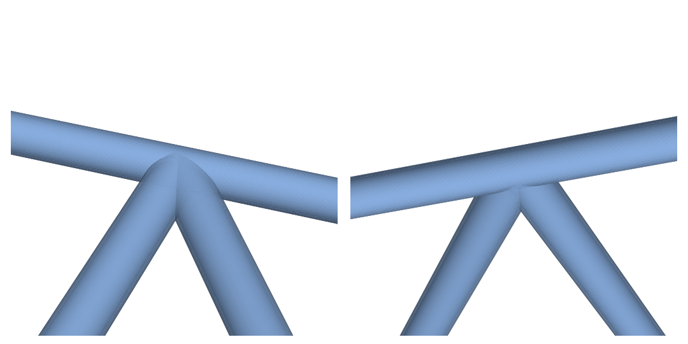
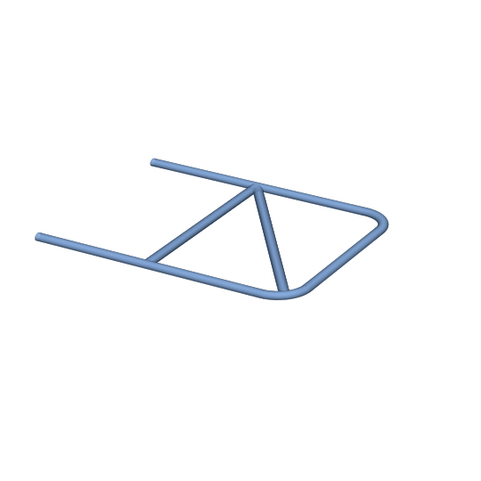

# TubeCraft

A [SolidCraft](https://github.com/tangency-labs/solidcraft) plugin that turns a sketch wireframe
into round tube for roll cages and tube frames. Draw the centrelines, then make each tube in
turn, each in its own size: bent where the wireframe has arcs, coped where it meets the tubes
already made, mitred or butted at free corners.


| A node: brace and diagonal coped under the hoop | The example wireframe as tube |
|---|---|
|  |  |

## Install

Needs SolidCraft 0.48.1 or later (tested with 0.49.1).

1. Download [`dist/tubecraft-0.4.0.zip`](dist/tubecraft-0.4.0.zip).
2. In SolidCraft: **Preferences › Plugins › Install plugin…**, pick the zip.
3. Review what it asks for (no folders, no network, no command groups) and choose **Install**.

## Use

1. Draw the centrelines in a sketch (flat or 3D). Join a bent tube's lines with tangent arcs at
   your die's centreline radius (CLR). End each tube's line on the centreline of the tube it
   lands on.
2. Run **Weldments › TubeCraft › tube**.
3. Pick the lines and arcs of **one** tube, in any order.
4. Choose the size, a name, the free-corner style, the cope, the weld gap and your die's CLR.
   The preview shows the tube with its copes; **Run** makes it as one undo step.
5. Run it again for the next tube.

Tubes are named `<name> 01`, `<name> 02` and on. Sizes: HREW round tube, OD 1.250, 1.500, 1.750
and 2.000 in, each in walls of 0.065, 0.095 and 0.120 in.

## What one run makes

| Wireframe | Result |
|---|---|
| Lines joined by tangent arcs | One bent tube; each arc is a bend at its own CLR |
| The new tube ends on an earlier tube | The new tube is coped to it |
| An earlier tube ends on the new tube, which runs through | The earlier tube's end is coped; the new tube stays whole |
| Several tube ends at one node | The new tube is coped to every earlier tube there |
| The new tube's end on an earlier tube's end, no other tube there | A free corner: mitred (same OD) or butted |
| The two tubes cross | The new tube is cut in two around the earlier one, with a warning |

A tube end is coped; a tube that runs through a joint is never cut. So the order the tubes are
made in does not change the result.

The **Cope** option chooses how an end is cut:

| Cope | The cut | For |
|---|---|---|
| Flush (default) | By the other tube's outside, so the whole wall touches it | A hole saw or notcher |
| Perpendicular | Square to the tube's own wall all the way round, trimmed back until no part of the wall is inside the other tube | A CNC tube laser |

The tubes are ordinary SolidCraft features (`solid.pipe` and cuts), each tube in its own
timeline folder, and they work without the plugin. Earlier tubes are found in the timeline:
any pipe feature that makes a new body counts, whether TubeCraft made it or not.

The run's reply gives the tube's centreline length, the stock length to cut
(`tube.cut_length_in`), each bend's angle and CLR, what the tube is coped and mitred to, the trim
of each perpendicular cope, and warnings such as a bend whose radius is not your die's.

## Limitations

- **A perpendicular cope does not follow the sketch.** Flush copes, miters and butts rebuild
  when the wireframe moves. A perpendicular cope's cut is fixed in space: after moving its
  lines, delete that tube's timeline folder and make the tube again.
- The helper sketches (`Cope ... lines`, `<tube> corners`) stay visible after a run, as small
  squares or ticks at the joint. TubeCraft hides them, but SolidCraft 0.48.1 to 0.49.1 show
  them again when a plugin's run ends. Hide them in the browser.
- A perpendicular cope falls back to the flush cope, with a warning, at an end in a bend, at a
  very shallow joint, and on an earlier tube that is a solid bar or cut in pieces.
- One run makes one tube, from curves in one sketch, with no sharp corners. Paths are lines and
  arcs (no splines); a 3D arc of 180° or more must be split in two.
- A pipe whose diameter uses parameters is not read as a tube (the run warns).
- A tube landing on a mitred corner from the side may be cut back slightly too far there.
- A design with more than about 240 pipe features is too large for one run.

## Build and test

Needs Rust and `solidcraft-cli`.

```sh
rustup target add wasm32-unknown-unknown
cargo test            # unit tests: geometry, planner, command sequence
cargo xtask test      # build, then the plugin cases on the real host
cargo xtask dist      # dist/tubecraft-<version>.zip
cargo xtask fixtures  # remake the test designs, after a change to the made geometry
```

| Path | Holds |
|---|---|
| `tubecraft/` | The package: manifest, built component, test cases |
| `tubecraft-plugin/` | The Rust crate that builds the component |
| `xtask/` | The build tasks |
| `fixtures/` | The runs that make the test designs holding earlier tubes |
| `examples/` | The example wireframe and designs made from the test runs |
| `dist/` | The release zip |
| `docs/DESIGN.md` | Rules, the commands used, how the perpendicular cope works, roadmap |

Each plugin case checks the volume SolidCraft measures. Those that can be worked out by hand
agree to 0.1 mm³.

## Licence

MIT OR Apache-2.0, at your option, as SolidCraft itself.
